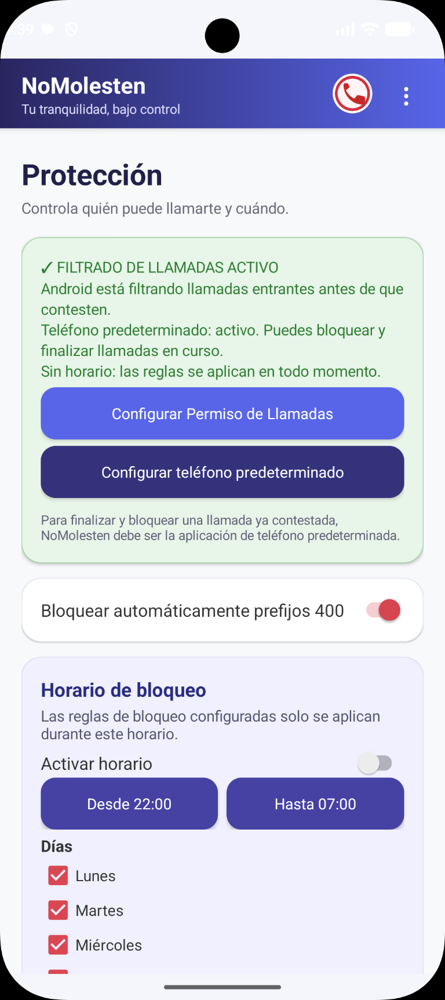
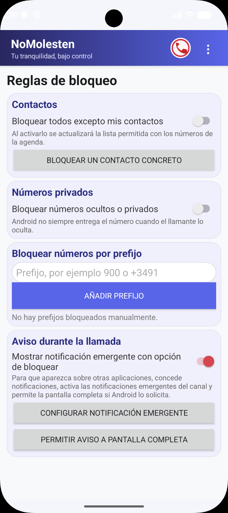
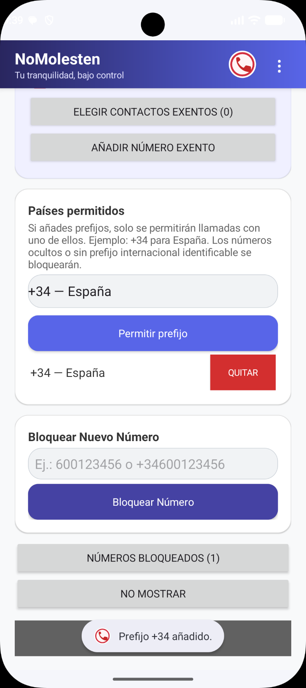
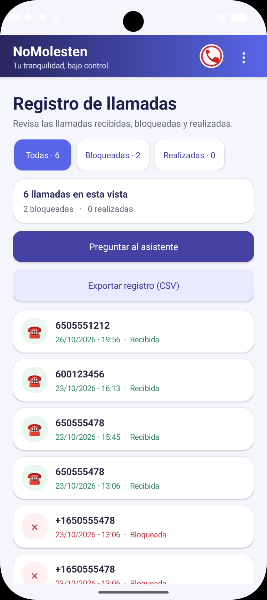
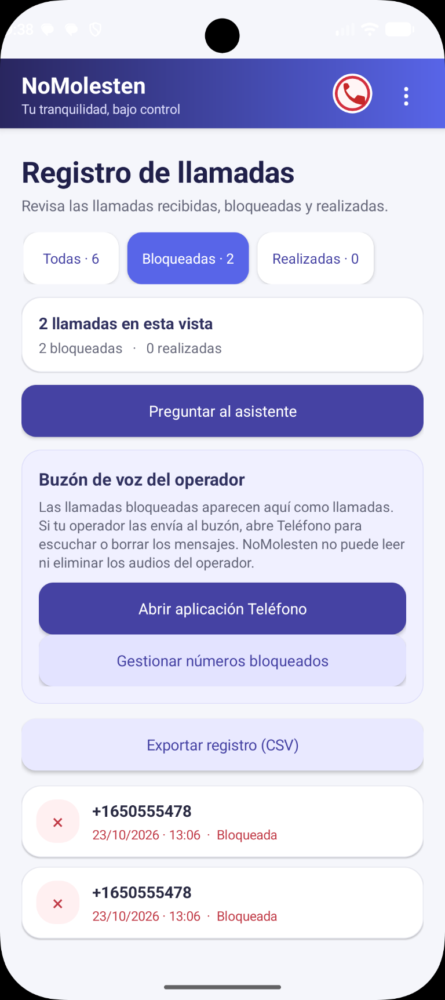
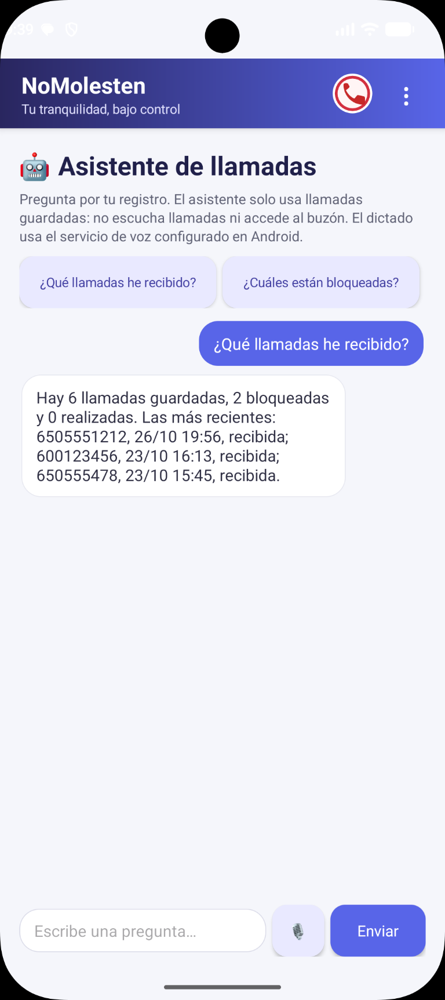

# NoMolesten (CodeForge)

Aplicación Android para filtrar llamadas no deseadas, gestionar excepciones y consultar el registro de llamadas desde el dispositivo.

> **Nombre del proyecto:** NoMolesten. «CodeForge» es el otro nombre con el que se identifica este proyecto.

## Capturas de pantalla

### Protección y horario



### Reglas de bloqueo



### Excepciones y prefijos permitidos



### Registro de llamadas



### Llamadas bloqueadas



### Asistente de llamadas



## Funciones

- Filtra llamadas entrantes mediante el servicio de filtrado de llamadas de Android.
- Permite bloquear números concretos, números privados, prefijos y llamadas fuera de la agenda, además de configurar el bloqueo del prefijo 400.
- Configura un horario semanal de bloqueo y permite seleccionar los días y las horas.
- Importa contactos para identificar llamadas y establecer excepciones.
- Mantiene un registro local de llamadas recibidas, bloqueadas y realizadas; permite consultar los datos y exportarlos como CSV.
- Incluye un asistente por texto y voz que responde preguntas sobre los datos del registro guardados en el teléfono.
- Ofrece notificaciones y avisos emergentes de llamadas, sujetos a los permisos y ajustes del dispositivo.

## Requisitos

- Android 10 o posterior.
- Android Studio o Android SDK instalado para compilar.
- Plataforma Android 35, herramientas de compilación y Java 17.

## Permisos y configuración inicial

1. Instala y abre la aplicación en el dispositivo.
2. Concede acceso a contactos si quieres importar la agenda y mostrar nombres.
3. En **Protección**, concede el rol **Filtrado de llamadas** para filtrar llamadas entrantes.
4. Si necesitas la pantalla propia de llamada, bloquear o colgar llamadas en curso, o registrar llamadas realizadas, configura NoMolesten como **Aplicación de teléfono predeterminada**. Android sustituirá el marcador predeterminado hasta que elijas otro en Ajustes.
5. En Android 13 o posterior, permite las notificaciones. Para mostrar avisos emergentes, revisa los permisos de pantalla completa y los ajustes del canal de notificación.

Las reglas dependen del rol de filtrado y de los permisos concedidos. El comportamiento de llamadas privadas y avisos puede variar según la versión de Android y el fabricante del dispositivo.

## Compilar el APK de depuración

Abre PowerShell en `ProtectorLlamadas400_Android` y ejecuta:

```powershell
$env:ANDROID_HOME = "$env:LOCALAPPDATA\Android\Sdk"
$env:ANDROID_SDK_ROOT = $env:ANDROID_HOME
.\gradlew.bat :app:testDebugUnitTest :app:assembleDebug
```

El APK se genera en:

```text
app\build\outputs\apk\debug\app-debug.apk
```

## Instalar en un emulador o dispositivo Android

Con el emulador iniciado o el móvil conectado con la depuración USB autorizada:

```powershell
$env:ANDROID_HOME = "$env:LOCALAPPDATA\Android\Sdk"
$adb = "$env:ANDROID_HOME\platform-tools\adb.exe"
& $adb devices
& $adb install -r .\app\build\outputs\apk\debug\app-debug.apk
& $adb shell am start -n es.berenguer.protectorllamadas400/.MainActivity
```

Para instrucciones detalladas de prueba, configuración del emulador y uso del dispositivo, consulta el [README del proyecto Android](ProtectorLlamadas400_Android/README.md).

## Privacidad y límites

- Los contactos importados, las reglas y el registro se guardan localmente en el dispositivo; el registro no se envía a un servidor.
- La aplicación no lee conversaciones, mensajes ni miembros de grupos de WhatsApp. Usa los nombres y números de la agenda del teléfono.
- El asistente consulta el registro local. El dictado usa el servicio de reconocimiento de voz configurado en Android y requiere permiso de micrófono; no lee el audio de las llamadas ni los mensajes del buzón de voz.
- Que una llamada bloqueada termine en el buzón depende del dispositivo y del operador. El buzón se gestiona desde la aplicación Teléfono y con el operador.
